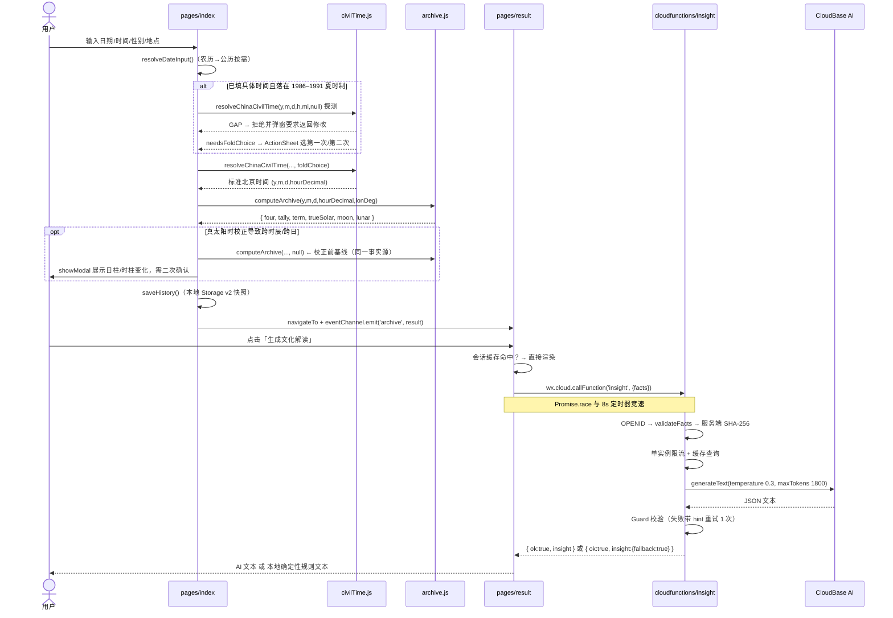
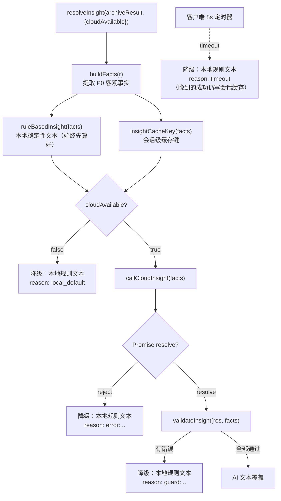

# 02 · 系统架构

## 1. 两层真相：目标分层 vs 当前实现

仓库按五目录分层设计（《Technical Architecture Specification v1.0》冻结），
但 README §迁移状态明确：**`engine/`、`insight/`、`shared/` 仍是目标分层，
尚未完全取代 `miniprogram/lib/` 的生产实现**。

```
目标目录职责（冻结）                      当前状态（2026-10-13）
─────────────────────────────────────    ──────────────────────────
miniprogram/   纯展示，禁止历法算法        ★ 生产主链；历法内核仍在 lib/
cloudfunctions/ API、鉴权、编排、限流       ★ insight 已实现（部署镜像）
engine/        TS 确定性历法、trace、hash    ○ 迁移中（仅 lib/types.ts）
insight/       知识源、prompt、Guard、缓存    ○ 空目录（未独立成模块）
shared/        跨层 schema、类型、hash 约定   ★ 冻结契约 + 测试已存在，
                                               生产接线未完成
```

依赖方向约束（架构契约，不可反向）：

```
miniprogram ─────────→ shared
cloudfunctions ──→ engine ──→ shared
             └──→ insight ─→ shared

engine 与 insight 不得互依；Cloud Function 编排两者
```

## 2. 生产链路数据流



## 3. 历法引擎的分层（`miniprogram/lib/`）

```
┌──────────────────────────────────────────────────────────────┐
│  archive.js · computeArchive()  ← 唯一对外组装入口             │
├──────────────────────────────────────────────────────────────┤
│  四柱层   engine.dayPillar/yearPillar + archive.monthPillar/  │
│          hourPillar（五虎遁月干 / 五鼠遁时干）+ 日界 applyDay  │
│          Boundary（CHANGE_AT_ZI 默认 / CHANGE_AT_MIDNIGHT）    │
├──────────────────────────────────────────────────────────────┤
│  时间层   civilTime.js → chinadst.js（墙钟→标准北京时间）       │
│          archive.trueSolarToLocal（真太阳时 = EoT + 经度差）    │
├──────────────────────────────────────────────────────────────┤
│  天文层   solarlon.js（VSOP87B + 章动 + 光行差 + FK5）          │
│          engine.js（JDN 换算、节气二分求根、EoT 级数）           │
│          archive.newMoonJde（Meeus 新月）→ lunarAge/Phase      │
│          sun.js（NOAA 日出日落）                               │
├──────────────────────────────────────────────────────────────┤
│  数据层   lunar-table.js（构建期生成的朔月表 1900–2100）        │
│          sunEphem.data.js（VSOP87B L/R + 63 项章动，代码生成）  │
│          place.js（省级/地级/区县名称 + 地级中心坐标）           │
├──────────────────────────────────────────────────────────────┤
│  展示层   display.js（全站时间/数值格式化单一事实源）            │
└──────────────────────────────────────────────────────────────┘
```

## 4. AI 分层与降级策略



设计要点：

1. **本地文本始终优先算好**，任何失败路径都是「直接用已经算好的东西」，不二次计算
2. 降级的 `reason` 分四类：`local_default` / `error:*` / `guard:*` / `timeout`，
   全部写入 `console.warn` 便于真机排查
3. 客户端缓存是**会话级** `Map`（上限 20），跨会话由服务端
   `cacheKey(docHash + promptVer + model + outputVersion)` 负责

## 5. 关键设计决策（ADR）

| 决策 | 结论 | 理由 |
|---|---|---|
| 跨端框架 | **不用**，原生小程序 + TS | 微信生态兼容性优先；避免构建层不确定性 |
| 历法引擎语言 | TS 重写（方案 B），与 Kotlin Core **golden 对拍**验收 | 不黑盒移植；对拍保证口径一致 |
| 云服务 | 微信云开发（CloudBase） | 免运维；自带 OPENID 上下文 |
| 双轨分离 | 比赛轨（受平台约束）与本体轨（Core/0.6 全语义域）共享事实层 | `governance/D-005_DUAL_TRACK_SEPARATION_v1.md` |
| 权威副本位置 | 云函数放 `miniprogram/cloudfunctions/insight/` | 微信工具要求云函数在项目根之下；根 `cloudfunctions/` 仅契约留档 |

## 6. 数据存储

| 位置 | 内容 | 生命周期 |
|---|---|---|
| `wx.Storage` key `eastTime.history.v2` | 历史档案（含完整 v2 输入快照，最多 50 条） | 设备本地持久 |
| `wx.Storage` key `eastTime.history.v1` | 旧版格式，读一次即迁移后删除 | 兼容期 |
| 页面 `SESSION_CACHE`（Map） | 本次会话的 AI 解读结果 | 小程序会话级，上限 20 |
| 云函数 `CACHE`（Map） | `insight` 结果，TTL 24h，上限 128，LRU | 单实例进程级 |
| 云函数 `RATE` / `MODEL_RATE`（Map） | 用户请求配额 / 模型调用配额 | 单实例进程级 |

`wx.Storage` **不存**任何云函数缓存或 AI 结果 —— 这是 V4 明确的收口
（避免模型版本切换后跨会话误用旧内容）。
