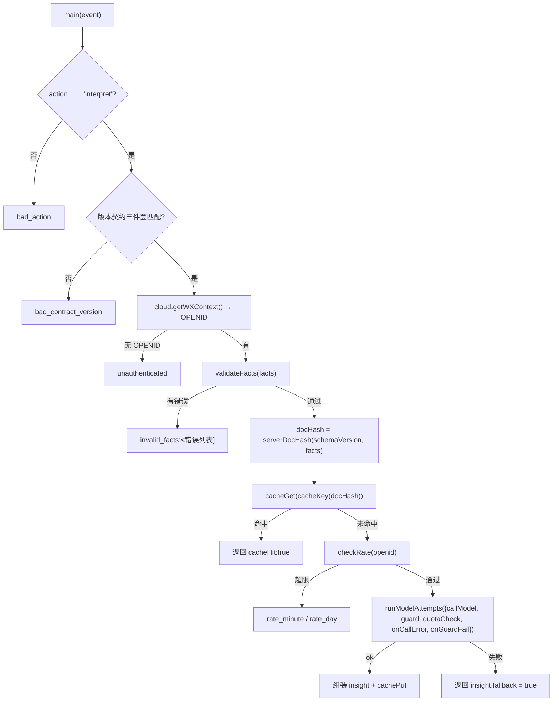
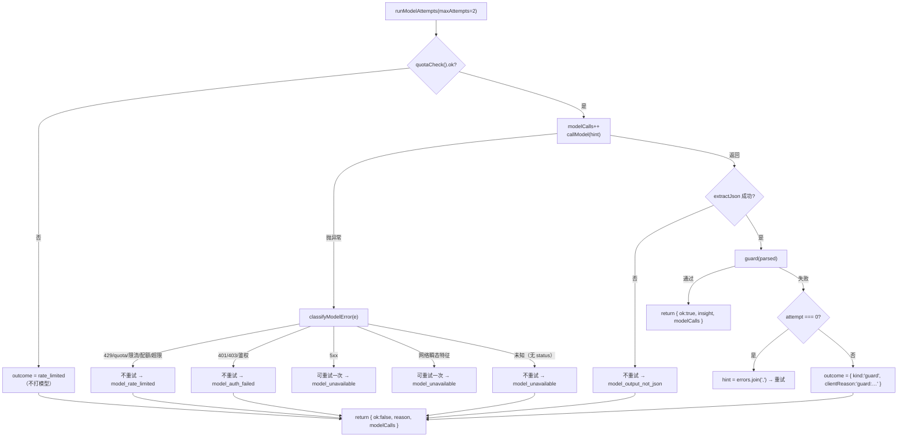

# 05 · AI 解读层与云函数

AI 层被拆成两半：客户端 `miniprogram/lib/insight.js`（事实抽取 + 降级 + 缓存）
和服务端 `insight` 云函数（鉴权 + 校验 + 限流 + 模型 + Guard）。

铁律：**AI 只解释确定性事实，不参与任何历法计算。**

## 1. 版本契约（两侧必须一致）

| 常量 | 值 | 位置 |
|---|---|---|
| `OUTPUT_VERSION` | `insight-1.1` | 客户端 `insight.js:14` / 云函数 `index.js:23` |
| `PROMPT_VER` | `insight-prompt-v3` | 客户端 `:15` / 云函数 `:24` |
| `SCHEMA_VERSION` | `archive-document-v1` | 客户端 `:16` / 云函数 `:25` |

云函数入口第一道门就是三者校验：

```js
if (action !== 'interpret')                 return jsonReply(false, { reason: 'bad_action' });
if (schemaVersion !== SCHEMA_VERSION
    || promptVer !== PROMPT_VER || !facts)   return jsonReply(false, { reason: 'bad_contract_version' });
```

## 2. 客户端：`miniprogram/lib/insight.js`

### 2.1 事实抽取 `buildFacts(r)`

从 `pages/result` 的展示结构提取 **AI 可见的 P0 客观事实**：

```js
{
  pillars: [{ label:'年'|'月'|'日'|'时', gan_zhi:'甲子'|null, element:'木'|null }],  // 1..4 项
  solarTerm: { prev: string|null, next: string|null },
  solarTime: { corrected: string|null, day_changed: boolean },
  lunar: string|null,
  wuxing: [{ name:'木'|'火'|'土'|'金'|'水', literal_count: 0..8 }],  // 恒 5 项
}
```

**AI 收不到的东西**：用户原始输入、性别、具体坐标、`docHash`（客户端不报）、
四柱拼接串、以及任何五行强弱判断。

### 2.2 会话缓存键 `insightCacheKey(facts)`

```js
JSON.stringify({ schemaVersion, promptVer, outputVersion, facts })
  → 双 FNV-1a 变体 (h1, h2)
  → `${OUTPUT_VERSION}:${PROMPT_VER}:${h1}:${h2}`
```

**这不是服务端 docHash**，只用于同一客户端避免重复发起请求，
必须随 schema/prompt/output 版本一起失效（三者都拼进了键里）。

### 2.3 本地规则文本 `ruleBasedInsight(facts)`

确定性模板，产出 4–7 个小节：

| id | 标题 | contentType | 触发条件 |
|---|---|---|---|
| `s0` | 总论 | CULTURAL_CONTEXT | 恒有 |
| `s1` | 节气坐标 | FACT | 恒有 |
| `s5` | 农历日期 | FACT | `facts.lunar` 存在 |
| `s2` | 四柱干支 | CULTURAL_CONTEXT | 恒有 |
| `s6` | 十二时辰与地支 | CULTURAL_CONTEXT | 时柱地支在 `ZHI_CULTURE` 有条目 |
| `s3` | 五行字面分布 | FACT | 恒有 |
| `s4` | 太阳时间与钟表时间 | FACT | `facts.solarTime.corrected` 存在 |

每节带 `evidenceIds`（`e_term` / `e_lunar` / `e_pillars` / `e_wuxing` / `e_solar`）
与 `limitations: ['仅解释客观历法事实', '不作任何判断、建议或未来推断', '云端 AI 未启用时使用本地规则文本']`。
返回对象固定 `fallback: true, model: 'rule-based-fallback'`。

### 2.4 客户端 Guard `validateInsight(insight, facts)`

| 检查 | 失败码 |
|---|---|
| 非对象 | `not_object` |
| `outputVersion` 不匹配 | `outputVersion` |
| `promptVer` 不匹配 | `promptVer` |
| `docHash` 非 64 位小写 hex | `docHash` |
| `sections` 空或非数组 | `sections` |
| `limitations` 空 | `limitations` |
| 命中禁词 | `banned:算命,占卜,…` |
| `contentType` 不是 FACT/CULTURAL_CONTEXT | `contentType:<i>` |
| `evidenceIds` 空或含未知 ID | `evidence_empty:<i>` / `evidence:<id>` |
| 出现给定事实之外的干支（`[甲乙…][子丑…]` 正则） | `invented_ganzhi:甲子` |

禁词表（32 个，客户端与服务端完全相同）：
算命、占卜、算卦、卜卦、运势、运程、流年、大运、注定、命中、吉凶、宜忌、化解、
犯太岁、开运、招财、转运、合婚、择日、看日子、八字算、排盘、预测、旺衰、喜用、
用神、忌神、十神、藏干、神煞、空亡、胎元、命宫、身宫。

### 2.5 降级编排 `resolveInsight(archiveResult, opts)`

```js
const facts   = buildFacts(archiveResult);              // 先抽事实
const local   = ruleBasedInsight(facts);                // 先算好本地文本
const cacheKey = insightCacheKey(facts);
if (!opts || !opts.cloudAvailable)
  return { insight: local, facts, usedAI: false, reason: 'local_default', cacheKey };

return callCloudInsight(facts)
  .then(res => {
    const errors = validateInsight(res, facts);
    if (errors.length) return { …reason: 'guard:' + errors.join('|') };
    return { insight: { ...res, fallback: false }, facts, usedAI: true, reason: 'ok', cacheKey };
  })
  .catch(e => ({ …reason: 'error:' + (e.errMsg || e.message || 'unknown') }));
```

`callCloudInsight` 是 `wx.cloud.callFunction` 的 Promise 包装：

- `wx` 或 `wx.cloud` 不存在 → reject(`cloud_unavailable`)
- 响应 `{ ok:true, insight:{ sections:[…] } }` → resolve(insight)
- 响应 `{ ok:true, insight:{ fallback:true } }` → reject(`cloud_fallback:<reason>`)
- 其他 → reject(`<reason>` 或 `bad_result`）

## 3. 服务端：`insight` 云函数

### 3.1 初始化与配置

```js
cloud.init({ env: cloud.DYNAMIC_CURRENT_ENV });
const tcbApp = tcb.init({ env: cloud.DYNAMIC_CURRENT_ENV });
const ai = tcbApp.ai();
```

环境变量与默认值（`cloudbaserc.json` 已写死一部分）：

| 变量 | 默认 | 含义 |
|---|---|---|
| `INSIGHT_MODEL` | `deepseek-v4-flash` | 模型 |
| `INSIGHT_RATE_MINUTE_MAX` | 6 | 单 OPENID 每分钟请求数 |
| `INSIGHT_RATE_DAY_MAX` | 40 | 单 OPENID 每日请求数 |
| `INSIGHT_MODEL_RATE_MINUTE_MAX` | 8 | 每分钟**模型调用**数（重试一次 = 2 次） |
| `INSIGHT_MODEL_RATE_DAY_MAX` | 60 | 每日模型调用数 |
| `INSIGHT_CACHE_TTL_MS` | 86400000 | 缓存 TTL |
| `INSIGHT_CACHE_MAX` | 128 | 缓存条数上限 |

部署参数：`timeout: 20`（秒）、`memorySize: 256`、`runtime: Nodejs16.13`。

> 用户请求配额与模型调用配额**分开记**：Guard 重试一次会让 1 次用户请求产生 2 次模型调用，
> 只按用户请求计数会低估成本与限流压力。

### 3.2 `exports.main(event)` 完整流程



### 3.3 事实校验 `validateFacts(facts)`

服务端**不信任客户端**，逐项白名单校验：

| 顶层键 | 约束 |
|---|---|
| 允许集合 | 仅 `pillars / solarTerm / solarTime / lunar / wuxing`，多余键 → `facts_unknown_key:*` |
| 总量 | `JSON.stringify(facts).length ≤ 8000` |
| `pillars` | 数组 1..4；每项仅 `label/gan_zhi/element`；`label` ∈ `年月日时` 且不重复；`element` ∈ 木火土金水；`gan_zhi` 长 2 且第 1 字 ∈ 十天干、第 2 字 ∈ 十二地支 |
| `wuxing` | 数组**恒 5 项**；每项仅 `name/literal_count`；name ∈ 木火土金水且不重复；`literal_count` 为 0..8 整数 |
| `solarTerm` | 对象，仅 `prev/next`；值长 ≤ 80 |
| `lunar` | 字符串长 ≤ 80 |
| `solarTime` | 对象，仅 `corrected/day_changed`；`day_changed` 必须 boolean |

### 3.4 服务端指纹 `serverDocHash(schemaVersion, facts)`

```js
function stable(v) { /* 递归 key 排序 */ }
serverDocHash = sha256(JSON.stringify(stable({ schemaVersion, facts })), 'utf8')  // 64 位 hex，无前缀
```

**不使用** `shared/hash` 的 canonical 实现 —— 这是 V4 已登记的不闭项：
当前服务端 hash 只覆盖 AI 所需事实子集，不能宣称完整 `ArchiveDocument/docHash` 生产链闭环。

缓存键 `cacheKey(docHash) = docHash : PROMPT_VER : MODEL : OUTPUT_VERSION`。

### 3.5 配额 `checkRate` / `checkModelRate`

```js
RATE.get(openid) || { minuteStart: now, minuteCount: 0, day, dayCount: 0 }
// 60s 滚动分钟窗 + UTC 日窗
// 返回 { ok:false, reason:'rate_minute'|'rate_day'|'model_rate_minute'|'model_rate_day' }
```

**这是单实例内存配额，只是第一层费用保护**，不是全局限流。
云函数可横向扩容，每实例各有一份 `Map`。公开大流量前需再接 CloudBase 数据库/网关全局配额。

### 3.6 输出 Guard `guard(insight, facts)`

| 检查 | 失败码 |
|---|---|
| 非对象 | `not_object` |
| `sections` 数量不在 1..6 | `sections_shape` |
| `limitations` 空 | `limitations_empty` |
| 命中禁词（32 个） | `banned:<词>` |
| 出现 `旺` 或 `衰`（哪怕是正常词的一部分） | `wangshuai` |
| `id` 不是 `s\d+` 或重复 | `section_id:<id>` |
| `contentType` 非法 | `contentType:<v>` |
| `content` 空或 > 400 字 | `content_length:<i>` |
| `evidenceIds` 空或含未知 ID | `evidence_empty:<i>` / `evidence_invalid:<id>` |
| FACT 小节未逐字引用输入事实 | `fact_mismatch:term_prev` / `:lunar` / `:pillar_<label>` / `:wuxing` / `:solar` |
| 出现给定事实之外的干支 | `invented_ganzhi:<干支>` |

`requireKnownFacts` 按**小节标题关键词**决定必须逐字出现哪些事实值
（标题含「节气」→ 必须含 prev/next 原文；含「农历」→ 必须含 `facts.lunar`；
含「四柱」→ 每个 `gan_zhi`；含「五行」→ 至少一对「名+计数」；
含「太阳时间」→ `facts.solarTime.corrected`）。

### 3.7 模型调用

```js
const res = await model.generateText({
  model: MODEL,
  messages: buildMessages(facts, repairHint),
  temperature: 0.3,
  maxTokens: 1800,
});
return extractJson(res?.content || '');
```

`buildMessages` = `SYSTEM_PROMPT` + 用户消息（facts JSON + 重试 hint）。
`SYSTEM_PROMPT`（11 条硬性约束）要点：

1. 只解释已给出的事实，不得补算/改动数值
2. 只输出文化与历法知识；禁止未来推断、结果判定、宜忌、行为建议
3. 禁止把五行字面计数说成强弱或个人结论
4. 禁词表逐条列出
5. 事实不足时输出「无法判定」
6. 禁止医疗/投资/法律/婚恋决策类结论
7. 禁止性格/事业/财运/婚姻/健康个人断言
8. 输出 4–6 个小节，第 1 节固定「总论」
9. 每节 120–320 字分两段（`\n\n`），FACT 小节引用事实必须逐字保留，单节 ≤ 400 字
10. `evidenceIds` 只能引用直接对应的证据 ID
11. 语气平实，避免宿命论措辞

### 3.8 重试状态机 `model-policy.js`



关键设计：**429/401/403 是 provider 明确拒绝，立刻重试只会放大成本与限流**
（终验 R3 修正：无 status 的未知异常也不再当 transient 重试）。
唯一应该自动重试的是「模型成功返回但没过我们自己的 Guard」。

### 3.9 错误分类 `classifyModelError`

```js
statusOf(err)   // err.status → err.statusCode → err.response.status → err.data.statusCode
                // → message/errMsg 中正则 \b(4\d\d|5\d\d)\b
```

正则规则（大小写不敏感）：

| 匹配 | 分类 |
|---|---|
| `429` 或 `rate limit / too many request / quota / exceed / 限流 / 配额 / 超限` | `rate_limited`，不可重试 |
| `401/403` 或 `unauthorized / forbidden / invalid api key / authentication / access denied / 签名 / 鉴权` | `auth_failed`，不可重试 |
| `status ≥ 500` | `server_error`，可重试 |
| `network / timeout / timed out / econnreset / econnrefused / etimedout / socket / fetch failed / dns / enotfound / eai_again / 超时 / 网络` | `transient`，可重试 |
| 其他 | `failed`，不可重试 |

### 3.10 日志脱敏 `redactProviderError`

CloudBase 日志同样不该出现密钥：

| 规则 | 替换 |
|---|---|
| `sk-[A-Za-z0-9_-]{6,}` | `sk-[REDACTED]` |
| `api_key=…` / `token: …` / `Bearer …` / `authorization` / `password` / `signature` / `sig` 等 | `$1$2[REDACTED]` |
| `\b(Bearer|Basic)\s+<token>` | `$1 [REDACTED]` |
| `https://host/path?query` | `$1?[REDACTED]` |

最终 `.slice(0, 300)`。

`clientReason` 是**唯一**允许回传给客户端的口径（`model_rate_limited` /
`model_auth_failed` / `model_unavailable` / `model_output_not_json` /
`guard:<errors>`），provider 原始报错只进服务端日志。

## 4. 云函数返回协议

```js
// 成功
{ ok: true, insight: {
    outputVersion, docHash, model, promptVer,
    sections: [...], limitations: [...], usedEvidenceIds: [...],
    fallback: false, cacheHit: false } }

// 服务端已降级（仍然 ok:true —— 客户端据此走本地文本）
{ ok: true, insight: {
    outputVersion, docHash, model, promptVer,
    sections: [], limitations: [...],
    fallback: true, reason: attempt.reason } }

// 失败（鉴权/契约/限流/facts 非法）
{ ok: false, reason: 'bad_action' | 'bad_contract_version' | 'unauthenticated'
                  | 'invalid_facts:…' | 'rate_minute' | 'rate_day' }
```

## 5. 客户端 8 秒降级（`pages/result/result.js`）

```js
const INSIGHT_TIMEOUT_MS = 8000;                  // 红线，不可调大
const SESSION_CACHE = new Map();                  // 会话级，上限 20
const work     = resolveInsight(archiveResult, { cloudAvailable: cloudReady });
const settled  = await Promise.race([work, timeout]);
if (!settled) {
  payload = resolveInsight(archiveResult, { cloudAvailable: false });  // 同步拿本地文本
  payload.reason = 'timeout';
  work.then(res => { if (res?.usedAI) cacheWrite(cacheKey, res.insight); });  // 晚到的成功仍写缓存
}
```

- 服务端上限更长（`timeout: 20`），仅用于让**已开始的**模型调用有机会完成并进服务端缓存
- `cacheRead` 会对缓存值做完整性校验（outputVersion / promptVer / docHash 形态 / model / sections / limitations），
  任一不满足即丢弃
- `cloudReady = !!(app.globalData.cloudEnvId && wx.cloud)` —— `cloudEnvId` 留空时全站走本地降级

## 6. 分享卡片（`onSaveCard`）

`wx.createCanvasContext('shareCard')` 画 600×760 画布：

- 深色/浅色两套调色板（读 `wx.getSystemInfoSync().theme`）
- 内容：标题 + 日期 + 四柱（大字）+ 农历/地点/坐标/前后节气/月相/真太阳时 + 五行字数条
- 文本截断 `clipText(str, maxW, fontSize)`，中文按 1 字宽、ASCII 按 0.55 字宽估算
- `canvasToTempFilePath` → `saveImageToPhotosAlbum`
- 权限被拒时 `wx.showModal` 引导授权（auth 相关 `errMsg` 判定）

## 7. AI 接入的已知踩坑（`docs/`）

| 现象 | 根因 | 处置 |
|---|---|---|
| 模型调用被拒 | CloudBase **计费模式**是旧配额制，不支持内置模型 | 切换「资源点计费」（个人版 19.9 元/月 + 免费额度） |
| AI 总是降级为本地规则 | 云函数 `timeout=3s` | 控制台改 60s（`cloudbaserc.json` 现为 20s） |
| SDK 调用失败 | `@cloudbase/node-sdk` 与微信官方 openapi 差异 | 见 `docs/AI接入排查指引.md` |
