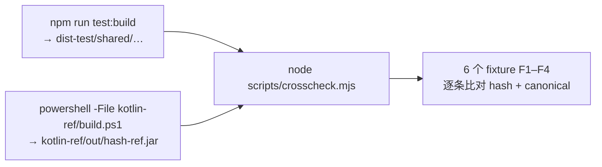

# 06 · 共享契约层

`shared/` 是跨层（miniprogram / cloudfunctions / engine / insight）唯一共享的
**协议、版本标识、类型与规范化约定的事实源**。

铁律：**本层只声明「协议」，不实现计算**；尽量无业务运行时依赖；
不存密钥、页面状态、数据库客户端、重复算法、可变全局状态。
所有字符串尽量 ASCII snake_case；数值只允许 INT / DEC 定点。

## 1. `protocol/` —— 版本与枚举

### 1.1 `versions.ts`

| 常量 | 值 | 来源 |
|---|---|---|
| `HASH_CONTRACT_VERSION` | `hash-contract-v1` | HASH_CONTRACT_V1 |
| `SCHEMA_VERSION` | `archive-document-schema-v1` | S-4 冻结稿 |
| `CORE_VERSION` | `bazi-core-1.3` | CALCULATION_BASELINE_V1 关键常量（实测核对） |
| `CHART_SCHEMA_VERSION` | `bazi-chart-1.1` | Core 实测 |
| `FACTS_SCHEMA_VERSION` | `calculated-facts-1.1` | Core 实测 |
| `ALGO_PREVIEW` | `suanming-preview-engine-1.0` | Preview 侧历法算法声明 |

聚合导出 `PROTOCOL_VERSIONS = { hashContract, schema, algorithm, chartSchema, factsSchema, algoPreview }`。
由 `tests/unit/protocol.test.ts` 做冻结值快照。

### 1.2 `enums.ts`

```ts
SolarTimeMode = { STANDARD, MEAN_SOLAR, TRUE_SOLAR }     // S-9 裁决 3 值，与 Core 一致
DayBound       = { ZI, MIDNIGHT }                        // Core DayBoundaryRule
CalendarKind   = { SOLAR, LUNAR }
DegradeReason  = { HOUR_UNKNOWN, LOCATION_ABSENT, TZ_DEFAULT_APPLIED,
                   SOLAR_TIME_DEGRADED, DT_EXTERNAL_ACCURACY_UNVERIFIED, TZDB_PLATFORM_LIMIT }
```

枚举值统一 ASCII UPPER_SNAKE_CASE（HASH_CONTRACT §10.2 Delta 2 要求 key 必须 ASCII）。

## 2. `domain/archiveDocument.ts` —— S-4 双 hash 契约

### 2.1 `ArchiveInput`（§2）

```ts
interface ArchiveInput {
  calendarType: 'SOLAR' | 'LUNAR';
  year: number; month: number; day: number;
  hour: number;          // 0..23；<0 表示「时辰未知」
  minute: number;        // 0..59；<0 表示未知
  isLeapMonth: boolean;
  placeId: string | null;      // 内置城市库 ID
  longitude: number | null;    // 东经正；入库 DEC(6)
  latitude: number | null;
  timezoneId: string | null;   // IANA
  solarTimeMode: 'STANDARD' | 'MEAN_SOLAR' | 'TRUE_SOLAR';
  dayBoundary: 'ZI' | 'MIDNIGHT';
}
```

> 注意 `consent`（知情同意）**不入 hash** —— 与 `engine/lib/types.ts` 的 S-4 §2 版本一致。

### 2.2 两条 hashScope

**`INPUT_HASH_KEYS`（14 键）→ `input_hash`**

```
calendar_type, day, day_boundary, hour, hour_unknown, is_leap_month,
latitude, longitude, minute, month, place_id, solar_time_mode,
timezone_id, year
```

**`DOC_HASH_KEYS`（19 键）→ `doc_hash`**

```
schema_version, algo_version, trace_version, input_hash,
solar_normalized, lunar, instant_iso, prev_term, next_term,
days_to_next_term, year_gan_zhi, month_gan_zhi, day_gan_zhi, hour_gan_zhi,
lon_diff_seconds, eot_seconds, total_offset_seconds, solar_time_degraded,
element_count
```

**排除集**（绝不入 scope）：`consent`、`_openid`、客户端元数据、`input_echo`、`trace`、`display`。

### 2.3 组装与断言

```ts
buildArchiveScope(input)  // 经纬度先 Q(v,6)；缺失选填字段编码为显式 null；
                          // hour < 0 → hour:null, hour_unknown:true
assertInputScope(scope)   // 键集 恰好 == 14 键，否则抛 HASH_SCOPE_SET_MISMATCH
computeInputHash(input)   // 先组装 → 断言 → computeHash

assertVersionLayer(v)     // P0 下 chart/facts_schema_version 必须为 null（TBD-2）
buildDocHashScope(v, inputHash, facts)  // DEC 字段 Q(v,6)；hour_gan_zhi null 显式保留
assertDocScope(scope)     // 键集 恰好 == 19 键
computeDocHash(v, inputHash, facts)
```

### 2.4 `ArchiveFacts`（§6 事实层）

```ts
{
  solarNormalized: { year, month, day, hour: number|null, minute: number|null, hourUnknown: boolean },
  lunar:          { year, month, day, isLeapMonth },
  instantIso:     string,
  prevTerm:       { name, instantIso, ordinal } | null,
  nextTerm:       { name, instantIso, ordinal } | null,
  daysToNextTerm: number,                    // DEC(6) 天
  yearGanZhi / monthGanZhi / dayGanZhi: string,
  hourGanZhi:     string | null,
  lonDiffSeconds / eotSeconds / totalOffsetSeconds: number,   // DEC(6) 秒
  solarTimeDegraded: boolean,
  elementCount:   { wood, fire, earth, metal, water },
}
```

## 3. `hash/` —— HASH_CONTRACT_V1 的 TS 参考实现

### 3.1 `hash.ts` `computeHash(value)`

```
1. assertTree(value, '$')      递归断言 P-1..P-7
2. canonicalSerialize(value)
3. Buffer.from(canonical, 'utf8')        显式 utf8（§5.1，禁止依赖默认编码）
4. createHash('sha256').update(bytes).digest('hex')
5. → { value: 'sha256:' + 64位小写hex, byteLength, env: fingerprint() }
```

`assertTree` 规则：

| 值 | 处理 |
|---|---|
| `null` / `string` / `boolean` / `bigint` | 放行 |
| `number` 非有限 | 抛 `HASH_RAW_FLOAT` |
| `number` 为 `-0` | 放行（后续归一为 `0`） |
| `number` 非整数 | 抛 `HASH_RAW_FLOAT` |
| `Array` | 逐项递归 |
| 普通对象 | `assertAsciiKeys` + `assertNoDuplicateKeys` + 逐值递归 |
| `undefined` / `function` / `symbol` | 抛 `HASH_INVALID_VALUE` |

**禁止直接 `JSON.stringify(obj)` 作 canonical**（契约 §15 #2）。

### 3.2 `canonical.ts`

基线 RFC 8785 (JCS) + 4 条 Delta：

| Delta | 内容 |
|---|---|
| 1 | 数值：禁裸浮点，只允许 INT / DEC(d) |
| 2 | key 字符集：限 ASCII 可打印、无需转义子集（正则 `^[\x20-\x7E]+$`） |
| 3 | 归一化：NFC + 白名单断言（`normalize.ts`） |
| 4 | 空值：显式保留 `null`，禁 `undefined` |

```ts
canonicalSerialize(value):
  null → 'null'   boolean → 'true'/'false'   string → serializeString
  bigint → toString()   number → toIntString（非整数/非安全整数即抛）
  Array → '[' + items.join(',') + ']'
  Object → '{' + keys.sort(compareAscii).map(k => str(k) + ':' + ser(v)).join(',') + '}'

serializeString(s)  仅转义 " \ \b \t \n \f \r 与 <0x20 的 \u00xx（小写 hex）；
                    非 ASCII（含中文）与 ASCII 可打印原样输出
```

### 3.3 `quantize.ts` `Q(v, d)`

```
Q(v, d) = sgn(v) · floor(|v| · 10^d + 0.5)
```

- 四舍五入、**远离零点**、正负对称（非银行家舍入，非 `Math.round` 负零偏置）
- `10^d` 用整数常量表 `POW10`（禁 `Math.pow`），`d ∈ 0..9`
- 非有限值抛 `HASH_RAW_FLOAT`
- 返回 `bigint`

### 3.4 `normalize.ts` 白名单与 NFC

白名单：**ASCII 可打印 `U+0020–U+007E`** 或 **CJK 统一表意 `U+4E00–U+9FFF`**。

流程（顺序不可交换）：

```
1. assertWhitelist(原始串)      ← 基于原始串逐码点判定，「落入即拒绝」
                                  （避免越界字符被 NFC 映射进合法区后误放行）
2. normalized = input.normalize('NFC')
3. 幂等断言：normalized.normalize('NFC') === normalized
4. assertWhitelist(normalized)  ← 防御性兜底
```

被拒绝的类别：CJK 兼容表意 `U+F900-`、全角 `U+FF00-`、组合记号、Jamo 等。

### 3.5 `fingerprint.ts` 环境指纹

```ts
EnvFingerprint = { node, unicode, icu, tz, lang, lcAll, hashContract }
```

即使 NFC 对合法输入退化为恒等变换，仍须记录宿主 Unicode/ICU 能力版本，
作为 B-6 跨语言一致的关闭证据之一。

## 4. `engine/lib/types.ts`

运行期类型/构造器，**不参与 docHash**（docHash 见 `shared/hash`）。
镜像 `shared/protocol` 的枚举，并定义 `ArchiveInput` / `SolarTermPoint` / `Ganzhi` /
`ElementCount` / `ArchiveFacts` / `TimeTraceEntry` / `ArchiveDocument`。

```ts
ArchiveDocument {
  schema_version, algo_version, trace_version,
  chart_schema_version: string | null,
  facts_schema_version: string | null,
  input_hash, doc_hash, facts, trace_hash, input_echo,
  // 服务字段（不入 docHash）
  doc_id?, created_at?, _openid?
}
```

两者字段命名风格不同：`engine/lib/types.ts` 用 snake_case（面向小程序侧运行时），
`shared/domain/archiveDocument.ts` 用 camelCase（面向 TS 契约层），
由 `shared/domain` 的 scope 组装负责转成 ASCII snake_case key。

## 5. `miniprogram/lib/archiveFacts.js` —— 适配器

把 `computeArchive` 产物映射为 S-4 §6 事实层，使 docHash 可由「引擎产物」直接计算
（B-6② 闭环的预留接线）。映射要点：

- 真太阳时**拆分**：engine 的 `trueSolar.offsetMinutes` 是总时差（分钟），
  §6 要求拆成秒 —— 用 `eotMinutes(jd)` 与输入 `lonDeg` 重拆：
  ```
  eotSeconds        = round(eotMinutes × 60)
  lonDiffSeconds    = round(4 × (lonDeg − 120) × 60)
  totalOffsetSeconds = lonDiffSeconds + eotSeconds   ← 由两个已舍入分量求和，保证恒等
  ```
- `solarTimeDegraded = !Number.isFinite(totalOffsetSeconds)`
- 农历落地日直接用 `arc.lunar`（表未覆盖则为 `null`，不伪造）
- `elementCount = arc.tally`

## 6. 跨语言对拍（`kotlin-ref/` + `scripts/crosscheck.mjs`）

Kotlin(JVM) 参考实现 `kotlin-ref/src/hashref/HashRefMain.kt`（单文件自包含，仅 JDK 原生）
与 `shared/hash` TS 实现，对同一逻辑文档产出同一 `docHash`。



对拍 fixture：

| 名称 | 测的点 |
|---|---|
| `F1-doc` | 混合文档（含中文、嵌套对象） |
| `F2-int` | INT 定点（`eot_seconds_scaled6`） |
| `F3-dec` | DEC 量化（等价 `Quantize.q(-3.7165835, 6)`） |
| `F4-null` | `null` 显式保留 |
| `F4-empty` | 空串（三态区分之二） |
| `F4-omit` | 字段省略（三态区分之三） |

负向（F-5）：全角 / CJK 兼容表意 / 组合锐音符 —— Kotlin 与 TS 两侧均被 P-3 拒绝。

规约对齐清单（两侧逐条一致）：

| 条目 | TS | Kotlin |
|---|---|---|
| §5 UTF-8 显式、无 BOM | `Buffer.from(s, 'utf8')` | `toByteArray(Charsets.UTF_8)` |
| §6 NFC | `String.prototype.normalize` | `java.text.Normalizer` |
| §6 白名单 | 原始串逐码点先行拒绝 | 同 |
| §7 INT | `number` 安全整数 | `Long` |
| §7 DEC | `Quantize.q` 十进制字符串 | `BigDecimal` + `HALF_UP` |
| §10 canonical | JCS + ASCII key 升序 + 保留 null | 同 |
| §11 SHA-256 | `node:crypto` | `MessageDigest` |
| §12 `-0` 归一 | `toIntString` | `String(0L)` |

## 7. 未闭项

完整 `ArchiveInput → ArchiveDocument → docHash → AIInsight` 冻结契约
**尚未真正接入生产**：

- `engine/lib/types.ts` 与 `shared/domain/archiveDocument.ts` 已冻结且有测试
- `miniprogram/lib/archiveFacts.js` 适配器已写好
- 但 `pages/index` → `pages/result` → 云函数的生产链路**没有调用** `computeDocHash`
- 云函数用的是 `serverDocHash()`（对 AI 事实子集规范化后 SHA-256，无 `sha256:` 前缀，
  不用 canonical / quantize / whitelist）

见 `docs/审查报告_COMPREHENSIVE_V4_2026-10-08.md`。
