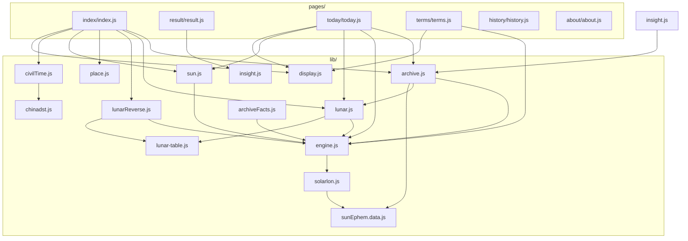
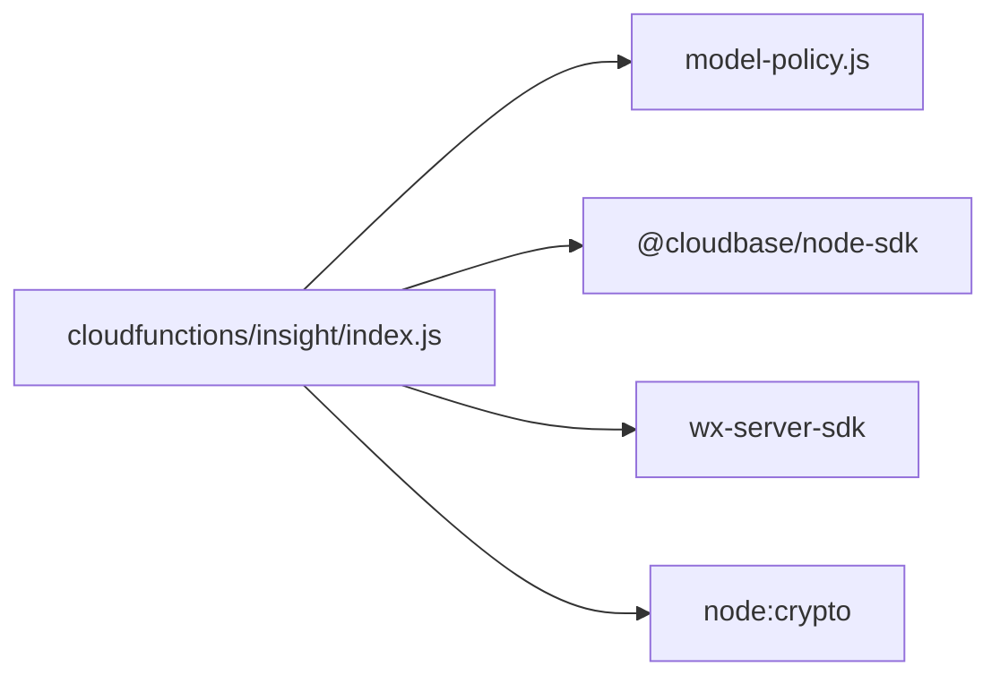
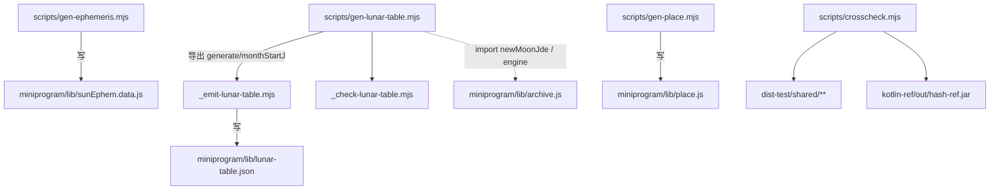

# 08 · 依赖关系

## 1. `miniprogram/` 内部模块依赖图



### 依赖矩阵（生产代码 `import` 关系）

| 模块 | imports |
|---|---|
| `archive.js` | `engine.js`, `lunar.js` |
| `engine.js` | `solarlon.js` |
| `solarlon.js` | `sunEphem.data.js` |
| `lunar.js` | `engine.js`, `lunar-table.js` |
| `lunarReverse.js` | `engine.js`, `lunar-table.js` |
| `civilTime.js` | `chinadst.js` |
| `sun.js` | `engine.js` |
| `insight.js` | `archive.js` |
| `archiveFacts.js` | `engine.js` |
| `display.js` | （无） |
| `place.js` | （无，单表自包含） |
| `lunar-table.js` | （无，纯数据） |
| `chinadst.js` | （无，硬编码表） |

**关键观察**：
- `display.js` / `place.js` / `lunar-table.js` / `chinadst.js` / `sunEphem.data.js` 是**叶子节点**
- `engine.js` 是历法层的枢纽（被 5 个模块依赖）
- **没有任何 `miniprogram/lib/*.js` 文件 import `shared/`** —— 生产小程序不依赖 TS 契约层

### 页面依赖

| 页面 | lib 依赖 |
|---|---|
| `index` | `archive.js`, `lunar.js`, `place.js`, `lunarReverse.js`, `sun.js`, `civilTime.js`, `display.js` |
| `result` | `insight.js` |
| `today` | `archive.js`, `engine.js`, `lunar.js`, `sun.js`, `display.js` |
| `terms` | `engine.js`, `display.js` |
| `history` | （无） |
| `about` | （无） |

### 页面间通信

```
index ──navigateTo + eventChannel.emit('archive', {result})──► result
today ──getCurrentPages()[n-2].applyToday(solar) + navigateBack──► index
history ──getCurrentPages()[n-2].applyHistory(r) + navigateBack────► index
```

不使用全局状态总线；跨页数据靠 `eventChannel`（前进）与页面栈方法回调（后退）。

## 2. 云函数依赖



| 依赖 | 用途 |
|---|---|
| `@cloudbase/node-sdk` | `tcb.init({env}).ai()` → `createModel('cloudbase').generateText()` |
| `wx-server-sdk` | `cloud.init({ env: DYNAMIC_CURRENT_ENV })` + `cloud.getWXContext().OPENID` |
| `node:crypto` | 服务端 `serverDocHash()` 的 SHA-256 |
| `./model-policy` | 错误分类 / 重试 / JSON 抽取 / 日志脱敏 |

`cloudfunctions/insight/package.json` 只声明上述两个 SDK（`node:crypto` 内置）。
**没有**依赖 `shared/` —— 服务端用自己简化的 `serverDocHash`。

## 3. 仓库根依赖（`package.json`）

```json
{
  "name": "suanming-preview",
  "version": "0.1.0",
  "private": true,
  "type": "module",
  "engines": { "node": "18.20.4" },
  "devDependencies": {
    "@types/node":       "^18.19.0",
    "eslint":            "^8.57.0",
    "globals":           "^17.12.0",
    "typescript":        "5.4.5",
    "typescript-eslint": "^7.7.0"
  }
}
```

| 依赖 | 精确度 | 用途 |
|---|---|---|
| `typescript` | **锁定到 5.4.5**（无 `^`） | `typecheck` + `test:build` 编译 |
| `eslint` | `^8.57.0` | `npm run lint` |
| `typescript-eslint` | `^7.7.0` | flat config 插件 |
| `@types/node` | `^18.19.0` | TS 的 Node 类型 |
| `globals` | `^17.12.0` | ESLint 全局变量集合 |

**运行期依赖为空** —— 小程序与云函数都不用 npm 包（云函数依赖在其自己的 `package.json`）。

安装必须走 `npm ci`（锁文件可复现），`preinstall` 钩子会先跑 Node 主版本守卫。

## 4. 构建期脚本依赖



数据生成是**单向的、构建期一次性**的，产物入库，运行期不再算。

| 脚本 | 输入 | 输出 |
|---|---|---|
| `gen-ephemeris.mjs` | `.tmp/VSOP87B.ear`（IMCCE）+ 章动表（可网络拉取） | `sunEphem.data.js` |
| `gen-lunar-table.mjs` | 无（仅算式），锚点 2023-01-22 正月初一 | `generate()` / `monthStartJ()` |
| `_emit-lunar-table.mjs` | `generate()` | `lunar-table.json` |
| `gen-place.mjs` | 民政部码 + 阿里 DataV areas_v3（需网络 + `.tmp/admin/`） | `place.js` |
| `crosscheck.mjs` | `dist-test/` + Kotlin jar | 对拍报告 |

## 5. 测试依赖

| 类别 | 依赖 |
|---|---|
| `.mjs` 测试 | `node:test` + `node:assert`；直接 import `miniprogram/lib/*.js`（ESM） |
| `.ts` 测试 | 需先 `tsc -p tsconfig.test.json` 编译到 `dist-test/`，再 `node --test dist-test/tests/unit` |
| 云函数测试 | `require('../../cloudfunctions/insight/...')`（CommonJS） |
| 镜像一致性测试 | `readFileSync` 读两个 `insight/index.js` 逐字节比对 |
| E2E | `miniprogram-automator`（**不入门禁**，需本机登录的微信开发者工具） |

## 6. TypeScript 工程接线

| 配置 | include | 说明 |
|---|---|---|
| `tsconfig.json` | `shared/**`, `engine/**`, `insight/**`, `scripts/**`, `tests/**/*.ts` | `noEmit: true`，仅 typecheck。**不含 `miniprogram/`**（小程序是 .js） |
| `tsconfig.test.json` | `shared/**`, `tests/**` | `outDir: dist-test`，`moduleResolution: Node`，把 `shared/` + `.ts` 测试编译成可跑 JS |

编译选项要点：`target ES2020`、`module ESNext`、`moduleResolution: Bundler`、
`strict: true`、`noUncheckedIndexedAccess: true`、`noImplicitOverride: true`、
`useUnknownInCatchVariables: true`、`exactOptionalPropertyTypes: true`、
`resolveJsonModule: true`、`isolatedModules: true`。

## 7. 运行时与外部服务依赖

| 依赖 | 版本/位置 | 说明 |
|---|---|---|
| 微信基础库 | 3.6.2（`project.config.json` libVersion） | 小程序运行时 |
| 微信云开发 | env `cloud1-d5ggz0479e06a5688` | 云函数托管 + OPENID + AI |
| CloudBase AI | 模型组 `cloudbase`，模型 `deepseek-v4-flash` | 文化文本生成 |
| 云函数 runtime | Nodejs16.13 | **平台侧事实**，与仓库 Node 18.20.4 工具链不同运行时 |
| Node（工具链） | 18.20.4 | `npm ci` / 门禁 / 测试 |
| JDK 17 + Gradle Wrapper 8.11.1 | Core Oracle 回归用 | 不在本仓库 `engines` 中 |
| kotlinc | `~/.workbuddy/binaries/kotlinc` | 跨语言对拍 jar 编译 |
| 微信开发者工具 | 本机 | 真机 E2E / 云函数部署 |

## 8. 上游 Core 依赖（非代码依赖，口径依赖）

```
_handover/Suanming-source-v0.21.0/
├── domain-bazi/         → archive.js 四柱（五虎遁/五鼠遁/日界）
├── domain-calendar/     → lunar*.js（农历）、archive.js（朔望）
├── domain-solar-term/   → solarlon.js（VSOP87D、ΔT）
├── domain-solar-time/   → chinadst.js / civilTime.js（真太阳时、夏时制、降级契约）
├── evaluation/          → fixture / canonical regression
└── preview-docs/        → 冻结规格（PRD / UIUX / Architecture）
```

关系性质：**口径对拍**（D-005 双轨分离），不是构建依赖。
Core 的 fixture（13 个）与 `calculationBaselineCheck` 是 Python 侧回归 Oracle 的入口，
但本仓库门禁只跑自己的 golden 测试。
