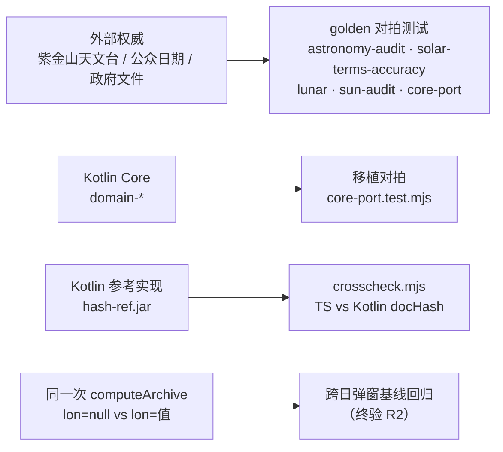

# 10 · 测试体系

## 1. 总览

| 指标 | 值 |
|---|---|
| 测试入口 | `npm run test:unit`（= `test:build` + `test` + `test:mjs`） |
| `node --test` 实际执行数 | **227**（mjs 199 + ts 28，2026-10-15 门禁当次输出） |
| 源码 `test()` 静态扫描数 | 223（mjs 195 + ts 28；动态生成的用例不计入） |
| `node:test` 文件数 | 29（26 个 `.mjs` + 3 个 `.ts`） |
| assert 直跑脚本 | 4（`sun` / `lunar` / `lunarReverse` / `archive-smoke`，无 `test()` 包装） |
| E2E | `tests/e2e/wechat-e2e.mjs`、`tests/e2e/culture-e2e.mjs`、`tests/e2e/bridge-ide.mjs`（IDE 自动化桥）（**均不进门禁**） |

`.ts` 测试先由 `tsconfig.test.json` 编译到 `dist-test/` 再执行；
`.mjs` 测试直接跑源码。

> **数字差异说明**：README 的「158 = TS 28 + mjs 130」是 2026-10-08 V4 closure 当次记录；
> V4 之后历次修复与科普功能持续新增守卫用例（`import-contract` / `insight-model-policy` /
> `ui-layout` / `cloudfunctions-sync` / `insight-contract` / `result-culture` / `today-culture` 等），
> 2026-10-15 门禁实测 227。**以 `npm run gate` 当次输出为准**，本 Wiki 不宣称具体通过数。

## 2. 单元测试矩阵

### 2.1 历法与天文

| 文件 | 用例数 | 覆盖 |
|---|---|---|
| `engine.test.mjs` | 9 | JDN 往返、J2000、春分/立春落点、年柱、prev/next bracket、EoT ±17min、ISO UTC 23:59:40 进位、越界抛错 |
| `archive.test.mjs` | 22 | 月柱（立春起寅）、时柱五鼠遁、四柱/五行 tally、真太阳时跨时辰/跨日 |
| `edge.test.mjs` | 13 | 1900/2100 极值、立春换年柱、23:00 早子时换日、小数小时进真太阳时、闰日、经度差 |
| `astronomy-audit.test.mjs` | 17 | 节气/朔/日柱/农历春节/闰月/端午与权威 Oracle 对拍（A1–A15、A17–A18，容差 ±3~8min） |
| `solar-terms-accuracy.test.mjs` | 5 | 与紫金山天文台 2026 年 24 节气三方交叉对拍（≤1min）、ΔT 分段多项式、TT/UT 换算方向（ST1–ST5） |
| `sun.test.mjs` | — | 日出日落旧版脚本（北京/赤道/夏至冬至），`node:assert` 顺序断言 |
| `sun-audit.test.mjs` | 4 | 北京夏至/冬至昼长 ±6min、正午 = 东八区钟面、经度越西日出越晚、高纬极昼/极夜 `valid=false`（S1–S4） |
| `lunar.test.mjs` | — | 阳历→农历黄金锚点（春节、公众节日、闰月） |
| `lunarReverse.test.mjs` | — | 农历→公历反查 |
| `moon-instant.test.mjs` | 2 | 朔望月龄随出生绝对时刻推进；时辰未知时以北京时间午正为代表时刻（MI1/MI2） |
| `archive-smoke.test.mjs` | — | `computeArchive` 1900–2100 全范围健壮性冒烟 |
| `place.test.mjs` | 5 | 省级全集完整（含港澳台）、地级坐标落在国界内且不重名、直辖市/普通省一致、区县无伪造占位 |

### 2.2 Core 移植能力

| 文件 | 用例数 | 覆盖 |
|---|---|---|
| `core-port.test.mjs` | 17 | 夏时制 12 次切换表、gap/fold、双时间轴（年月柱用绝对瞬间、日时柱用太阳钟）、子时换日双策略 + 晚子时五鼠遁、>60° 降级契约（CD/TA/ZI/DG 组） |
| `civil-time.test.mjs` | 5 | GAP 必须拒绝、FOLD 显式选择、校正跨日同步回退（CT1–CT5） |

### 2.3 展示与工程

| 文件 | 用例数 | 覆盖 |
|---|---|---|
| `display.test.mjs` | 8 | `display.js` 确定性：UTC 原文/本地时区、剩余天数档位、月龄、真太阳时分钟、经度 |
| `ui-layout.test.mjs` | 3 | WXSS 布局守卫：`height+line-height` 的 button 必须置零垂直 padding；`text-align:center` 与 button 类不得带 `letter-spacing`（L1–L3） |
| `import-contract.test.mjs` | 1 | **静态门禁**：`miniprogram` 全部具名导入必须真实存在于目标模块 |
| `archiveFacts.test.mjs` | 3 | 集成闭环：engine 产物 → adapter → `computeDocHash`（hash 稳定、键集断言、太阳时差拆秒） |

### 2.4 TS 契约测试

| 文件 | 用例数 | 覆盖 |
|---|---|---|
| `protocol.test.ts` | 4 | `PROTOCOL_VERSIONS` 与枚举冻结值快照、`solar_time_mode` 三值、ASCII 枚举无重复 |
| `hash.test.ts` | 15 | HASH_CONTRACT §14 自检 fixture F-1..F-5：中文 UTF-8 原样（禁 `\uXXXX`）、key 码点排序、负号与 `-0` 归一、DEC(d) 量化、`null` / `""` / 省略三态可区分、CJK 兼容/全角/组合音符白名单拒绝 |
| `archiveDocument.test.ts` | 9 | S-4 §7：`inputHashScope` 恰 14 键、`hour_unknown` 三态、经纬度 DEC(6)、同输入稳定 hash、`docHash` 19 键集、版本层非 null chart/facts 抛错 |

### 2.5 AI 与云函数

| 文件 | 用例数 | 覆盖 |
|---|---|---|
| `insight.test.mjs` | 16 | 输出确定性、禁词、`buildFacts` 字段契约、`onLoad` 不自动触发、服务端 `validateFacts`、**I12 镜像同步**、鉴权/限流/指纹缓存（I1–I16） |
| `insight-model-policy.test.mjs` | 15 | 429/401/5xx/非 JSON 失败分类、Guard 带 repair 重试一次、配额降级、日志脱敏（MP1–MP13） |
| `insight-contract.test.mjs` | 8 | 三侧契约一致：禁词表 / 证据 ID / 版本常量在客户端、云函数、部署镜像强制对齐；查「第二套硬编码值」 |

### 2.6 文化科普与内容 Guard

| 文件 | 用例数 | 覆盖 |
|---|---|---|
| `culture-data.test.mjs` | 11 | 知识库完整性（字段 / 分类 / 关联可达 / 表格列数）、**PRD §1.2 禁词逐字扫描**、与引擎常量一致（干支表 / 节气黄经）、检索语义、面板装配 `culturePanelOf`、开关语义 `cultureToggle`（CD1–CD11） |
| `culture-pages.test.mjs` | 9 | 科普列表/详情两页的页面逻辑：装配、搜索、分类、跳转、分享、无效 id 兜底；**wxml 绑定方法必须在页面 JS 中存在**（CP1–CP9） |
| `result-culture.test.mjs` | 9 | 档案页就地科普：ⓘ 展开/收起/切换/死链静默、**锚点 data-id 防死链**、面板与开关一一对应、文案与引擎口径一致（RC1–RC9） |
| `today-culture.test.mjs` | 5 | 今日天时页同套锚点接线与防死链（TC1–TC5） |

## 3. 特有的守卫测试

### 3.1 `ui-layout.test.mjs` —— 真机踩坑回归

不是运行时断言，而是**静态扫描** `miniprogram/**/*.wxss`：

- 同时声明 `height` 与 `line-height` 的 button 必须把垂直 padding 置零
- `text-align: center` 与 button 类不得带 `letter-spacing`

这两条都是真机上文字被裁/偏移的回归教训，写成了门禁。

### 3.2 `import-contract.test.mjs` —— 静态导入契约

扫描 `miniprogram/**/*.js` 的全部具名导入，断言每个名字在目标模块中真实存在。
产生背景：**2026-10-08 E2E 发现 `hourPillar` 导入为 `undefined`**，
原因是 `pages/today/today.js` 的导入路径写错。
这类问题 typecheck 抓不到（小程序是 `.js`，不在 `tsconfig.json` 的 include 里）。

### 3.3 云函数双副本一致性（I12 + cloudfunctions-sync）

`tests/unit/insight.test.mjs:126` 的 I12 负责两件事：

```js
const fn     = readFileSync(resolve(__dirname, '../../cloudfunctions/insight/index.js'), 'utf8');
// …validateFacts 必须先于 callModel…
const mirror = readFileSync(resolve(__dirname, '../../miniprogram/cloudfunctions/insight/index.js'), 'utf8');
assert.equal(mirror, fn, 'cloudfunctions/ 与 miniprogram/cloudfunctions/ 须同步');
```

即「`validateFacts` 必须先于 `callModel`」+ `index.js` 逐字节一致。
**文件集合层面**的一致性由 `scripts/sync-cloudfunctions.mjs`（`check` / `write` / `list`）承担：
全文件比对而非只比 `index.js`，`MIRROR_ONLY_ALLOWED` 显式登记唯一例外（根 `cloudfunctions/README.md`），
其余未登记差异一律失败。其自校验含「临时目录注入漂移」的负向测试，见
`tests/unit/cloudfunctions-sync.test.mjs`（S1–S8）。

## 4. 对拍（Golden / Oracle）机制



核心思想：**对拍失败要暴露，不静默修正**。
农历 `day` 的朔日 ±1 边界、`approx: true` 标记都是「显式暴露已知近似」的产物。

## 5. 冒烟与调试脚本（非 `node:test`）

| 脚本 | 用途 |
|---|---|
| `tests/smoke-engine.mjs` | 手工 sanity 核对。打印 JDN 往返、2000 日柱、节气时刻、`buildFacts` JSON、EoT 值 |
| `tests/_simulate_generate.mjs` | 用 2003-01-30 13:50 及多种 hour/经度组合调用 `computeArchive`，定位「生成」链路字段断裂 |

## 6. E2E（`tests/e2e/wechat-e2e.mjs` 12 项 + `tests/e2e/culture-e2e.mjs` 6 项）

不进 `npm run gate`，需本机已登录的微信开发者工具 + `miniprogram-automator`，
经 `cli auto --auto-port <空闲端口>` 建立自动化 ws 会话（端口见 wiki 09 §9）。
2026-10-15 模拟器实测：wechat-e2e 11 PASS + 1 BLOCKED（云端模型 429 限流，外部阻断）；
culture-e2e 6/6 PASS。一键编排见 `scripts/tools/e2e-orchestrator.mjs`。

| 覆盖项 | 断言 |
|---|---|
| 夏时制 GAP | 弹窗拒绝，不生成档案 |
| 夏时制 FOLD | ActionSheet 出现，选第一次/第二次分别得到不同日柱判断 |
| 23:00 日界 | 早子时换日后日柱正确 |
| 真太阳时跨时辰/跨日 | 二次确认弹窗内文案含正确的日柱/时柱变化 |
| 历史 v2 重新生成 | 回填后可复现同样结果 |
| AI 本地降级 / 8s 超时 | 无云环境或超时显示「本地规则」 |
| AI 云端成功 | 显示「AI 生成」 |
| 分享卡 → 相册 | canvas 生成并保存 |
| 深色模式 | 配色分支正确 |
| 分享深链 | path 正确 |

`culture-e2e.mjs` 覆盖科普两页：列表真实渲染（19 卡片 + 6 分类 chips + 计数）、
真实输入检索（命中/计数/清空/空态）、分类筛选（数据与 DOM 同步）、详情装配与分享回调、
关联概念 redirectTo 跳转（返回栈不增长）、无效 id 深链 toast 兜底。
期望条数从 `miniprogram/lib/culture-data.js` 现算（不硬编码，防知识库扩张后陈旧）。

失败信息中会提示「线上云函数仍是 V4 之前版本，需重新部署」。

## 7. 测试运行时的关键配置

```bash
node --test --experimental-vm-modules dist-test/tests/unit
node --test --experimental-vm-modules tests/unit
```

`--experimental-vm-modules` 是 mjs 测试 `import` ESM 源码所必需的。
CI 中额外固定 `TZ=UTC`、`LANG=C.UTF-8`、`LC_ALL=C.UTF-8`（消除 locale/tz 导致的 hash 与时间格式化漂移）。

`.gitattributes` 强制 `* text=auto eol=lf`，确保跨平台 hash 与文本确定性（B-6 环境侧配套）。
