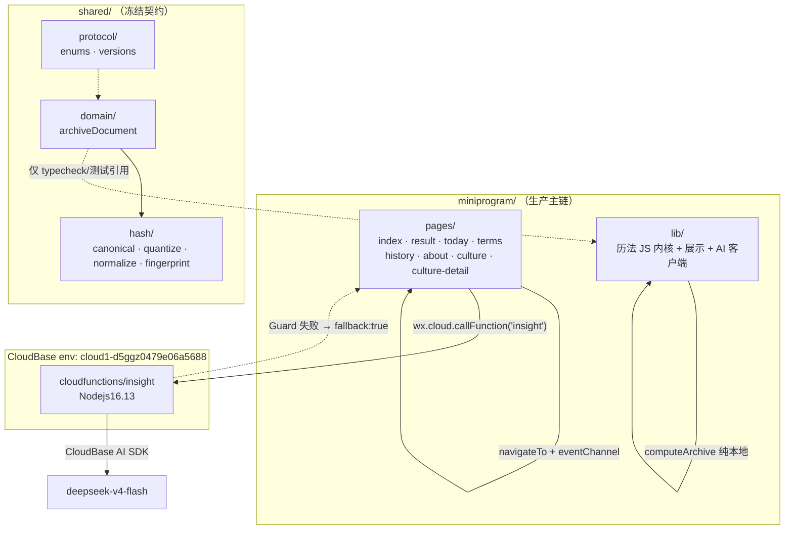

# Suanming Preview · Code Wiki

> 本 Wiki 是对 `suanming-preview` 仓库（东方时间文化档案微信小程序）的工程化代码文档。
> 生成时间基准：2026-10-13 · 代码基线：git `2a7a1b5`（V4 closure + 终验 R1–R3 修复）；
> **最近同步：2026-10-15**（工作树含未提交改动：科普功能与就地科普 ⓘ、mini typecheck、
> 云函数同步校验等，详见 [11-治理与文档索引](11-治理与文档索引.md)）。
>
> **重要适用范围声明**：本 Wiki 描述的是**工程实现事实**。当与冻结规格文档冲突时，
> 规格文档优先（详见 [11-治理与文档索引](11-治理与文档索引.md)）。

---

## 一分钟速览

| 项 | 值 |
|---|---|
| 产品名 | 东方时间文化档案（Suanming Preview） |
| 形态 | 原生微信小程序 + CloudBase 云函数 |
| 仓库 | `suanming-preview`（独立 git 仓库，非 monorepo 子目录） |
| npm 包名 / 版本 | `suanming-preview` / `0.1.0`（private） |
| Node 工具链 | **18.20.4**（`.nvmrc` + `engines` 双固定） |
| TypeScript | 5.4.5（精确版本） |
| 微信基础库 | libVersion 3.6.2 |
| AppID | `wxd58dc3b769e05f93` |
| CloudBase Env | `cloud1-d5ggz0479e06a5688` |
| 云函数运行时 | Nodejs16.13（平台事实，与仓库 Node 18 工具链**不是同一运行时**） |
| 生产 AI 模型 | `deepseek-v4-flash`（CloudBase `cloudbase` 模型组） |
| 覆盖历法范围 | 公历 1900–2100 |
| 门禁测试 | `node:test` 用例：mjs 199 + TS 28 = **227**（2026-10-15 门禁实测；README 登记的 2026-10-08 基线为 158） |

---

## 文档导航

建议按下列顺序阅读：

### 第一层 · 全局视角

| 文档 | 内容 |
|---|---|
| [01 · 项目总览](01-项目总览.md) | 项目定位、产品边界（做什么/不做什么）、能力清单、里程碑 |
| [02 · 系统架构](02-系统架构.md) | 目标分层 vs 当前现实、生产链路数据流、AI 降级策略 |
| [03 · 模块职责](03-模块职责.md) | 目录逐层职责、文件清单、权限边界（谁能依赖谁） |

### 第二层 · 核心实现

| 文档 | 内容 |
|---|---|
| [04 · 历法引擎详解](04-历法引擎详解.md) | 确定性历法内核：天文算法、四柱、真太阳时、农历、夏时制 |
| [05 · AI 解读层与云函数](05-AI解读层与云函数.md) | 客户端 insight、云函数编排、Guard、限流、缓存、降级 |
| [06 · 共享契约层](06-共享契约层.md) | `shared/` 协议、版本、hash 契约（HASH_CONTRACT_V1） |

### 第三层 · 查阅手册

| 文档 | 内容 |
|---|---|
| [07 · 关键类与函数参考](07-关键类与函数参考.md) | 各模块导出 API 签名、参数、返回值、调用要点 |
| [08 · 依赖关系](08-依赖关系.md) | 模块依赖图、外部依赖、运行时依赖、数据流图 |
| [09 · 运行、构建与部署](09-运行构建与部署.md) | 环境准备、门禁入口、测试命令、云函数部署 |
| [10 · 测试体系](10-测试体系.md) | 29 个测试文件（26 mjs + 3 ts）的覆盖矩阵、对拍机制、E2E |
| [11 · 治理与文档索引](11-治理与文档索引.md) | 冻结规格、治理裁决、审计报告、参赛材料定位 |

---

## 架构一图流

> 实线表示生产数据流；虚线表示契约/编译期关系。

---

## 三条不可逾越的铁律

1. **AI 只解释事实，不参与计算**
   历法计算全部在客户端本地确定性完成；AI 收到的只能是「已经算好的客观事实」，
   不得补算、不得改写数值。见 [05](05-AI解读层与云函数.md)。

2. **AI 必须用户显式触发，8 秒即降级**
   `pages/result/result.js:7` 固定 `INSIGHT_TIMEOUT_MS = 8000`，
   超时/失败/Guard 不通过一律回落到本地确定性规则文本，不阻断主链路。

3. **不算命 / 不预测 / 不判定吉凶**
   可见层禁词表见 `miniprogram/lib/insight.js:18` 与云函数 `index.js:44`（两者互为镜像），
   并由 `scripts/check-appjson-privacy.mjs` 在门禁中扫描生产源码；
   科普知识库另受 `tests/unit/culture-data.test.mjs` 逐字禁词扫描，
   三侧一致性由 `tests/unit/insight-contract.test.mjs` 强制。

---

## 已知未闭项（禁止对外写成「已完成」）

1. 完整 `ArchiveInput → ArchiveDocument → docHash → AIInsight` 冻结契约**尚未接入生产**；
   当前服务端 hash 仅覆盖 AI 所需事实子集。
2. AI 限流为**单实例内存配额**（6 次/分、40 次/日）；公开大流量前需数据库/网关级全局配额。
3. 云函数仍是部署镜像双副本（**非单一物理源**）：`tests/unit/insight.test.mjs` I12 强制
   `index.js` 逐字节一致；`scripts/sync-cloudfunctions.mjs` + `tests/unit/cloudfunctions-sync.test.mjs`
   将**全文件集合**比对也纳入门禁（唯一登记例外：根 `cloudfunctions/README.md`）。
4. 云函数 runtime 仍为 Nodejs16.13。
5. 区县级真实经纬度未落地；当前为地级行政中心近似坐标并已在 UI/文档披露。
6. 开发者工具**模拟器** E2E 已于 2026-10-15 全绿（wechat-e2e 11 PASS + 1 外部 429 BLOCKED；
   culture-e2e 6/6）；**真机**（手机预览/相册权限/深浅色视觉）回归仍需在提交比赛前人工完成。
7. `pages/culture` / `pages/culture-detail` 为科普定位下的增量扩展页面，**不在冻结七页 IA 之列**；
   已在治理层完成追加登记（**D-006**，2026-10-15 代行签收，见 `governance/PHASE0_DECISION_LOG.md`）；
   对外表述仍不得宣称「IA 与冻结规格完全一致」——登记的是偏差形态（6 页 → 8 页），不是一致性。
